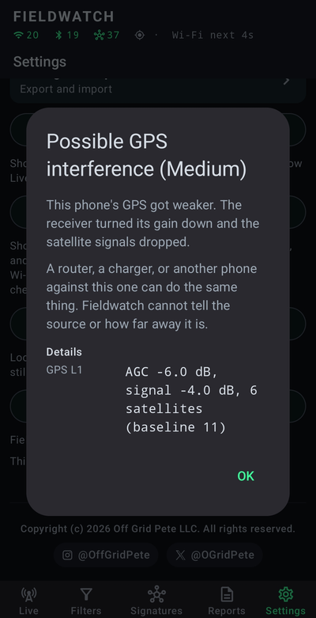
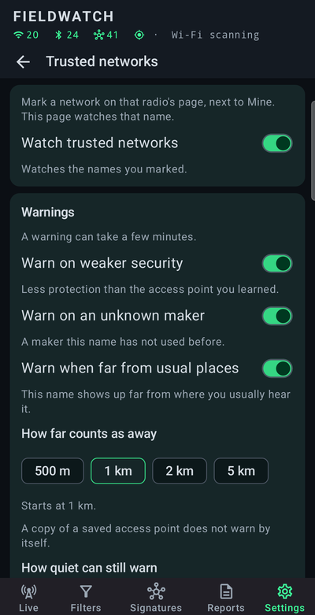
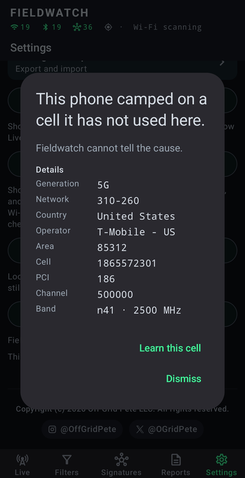
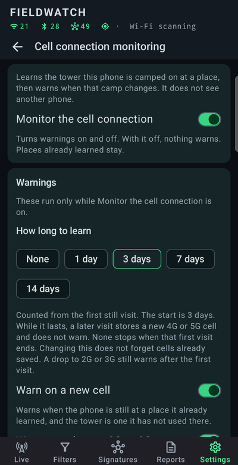
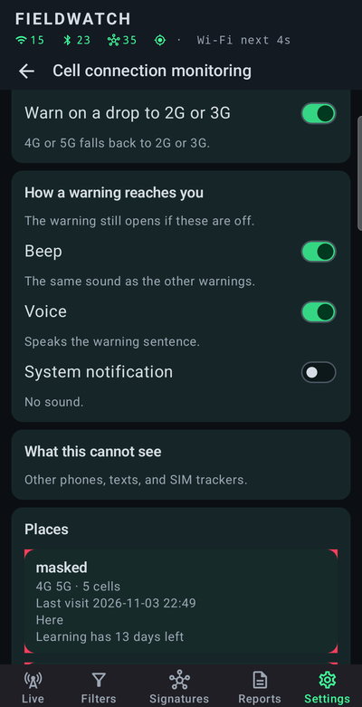

# Fieldwatch

I built Fieldwatch as a personal tool to see which Wi-Fi access points and Bluetooth LE devices my phone could detect, so I could better understand what was operating around me. It is entirely passive and only listens. There is no dongle, no account, and no backend server. It works offline in the field.

My goals were a modern, easy-to-use interface; flexible, customizable views; a filtering engine so I only see what matters; an extensible signature library so I can identify as many radio sources as possible and add new ones on the fly; and the ability to generate reports of what was observed.

I have been using it and iterating on it for a while now, and it has been useful enough that I thought I would share it.

This is a hobby — something I do for fun in my spare time. There is no Fieldwatch backend. There are no ads. Everything lives on the phone. Source and sideload files are in this repository (`dist/` for the APK, instruction card, and manual).

If you spot an error, something stupid, or have a feature idea — in the app or the documentation — please [open an issue on this repository](https://github.com/OffGridPete/Fieldwatch/issues). This is how we make it better. I hope you find it as useful as I have. I look forward to hearing how it goes.

**Just want to install it?** Download [Fieldwatch.apk](https://github.com/OffGridPete/Fieldwatch/raw/main/dist/Fieldwatch.apk). Instruction card and manual: [instruction.txt](https://github.com/OffGridPete/Fieldwatch/raw/main/dist/instruction.txt), [Fieldwatch_User_Manual.pdf](https://github.com/OffGridPete/Fieldwatch/raw/main/dist/Fieldwatch_User_Manual.pdf). [What’s new](CHANGELOG.md) is the changelog for each build. Leave the APK named `Fieldwatch.apk`. GitHub may say the file is too big to preview — that is their viewer; use Download.

There is a lot of functionality in Fieldwatch. I wrote a comprehensive user guide, and I encourage you to [download it](https://github.com/OffGridPete/Fieldwatch/raw/main/dist/Fieldwatch_User_Manual.pdf) so you can get the most out of the app.

**Stay updated.** Fieldwatch isn't on the Play Store. Install [Obtainium](https://github.com/ImranR98/Obtainium) and add https://github.com/OffGridPete/Fieldwatch. It can download and install a new release for you.

**Official builds.** The only official Fieldwatch builds are the releases in this repo. Other builds and translations are not made or reviewed by Off Grid Pete LLC.

## On the phone

<table>
  <tr>
    <td align="center" valign="top" width="33%">
      
      <br><strong>Signatures</strong>
      <br>More than 250 signatures, in classes. Bookmark one to alert, or add your own.
    </td>
    <td align="center" valign="top" width="33%">
      
      <br><strong>Bluetooth floods</strong>
      <br>A burst of new pairing addresses at the same loudness. The advertisement does not name the tool.
    </td>
    <td align="center" valign="top" width="33%">
      
      <br><strong>GPS</strong>
      <br>A warning when this phone's GPS changes in a way that can mean interference. It does not say where that came from.
    </td>
  </tr>
  <tr>
    <td align="center" valign="top">
      
      <br><strong>Trusted networks</strong>
      <br>A Wi-Fi name you marked can warn if it comes back weaker, from a new maker, or far from its usual places.
    </td>
    <td align="center" valign="top">
      
      <br><strong>Known cameras</strong>
      <br>Saved lists of plate readers and other sensors. Those marks sit on the map with the radios the phone hears.
    </td>
    <td align="center" valign="top">
      
      <br><strong>Live map</strong>
      <br>What the phone hears, on the path you walked.
    </td>
  </tr>
  <tr>
    <td align="center" valign="top">
      
      <br><strong>Hunt</strong>
      <br>Walk a Bluetooth radio down by loudness. Warmer color is where this phone heard it stronger.
    </td>
    <td align="center" valign="top">
      
      <br><strong>Filters</strong>
      <br>Cut the list to Wi-Fi or Bluetooth, a strong signal, what moves with you, or what is new.
    </td>
    <td align="center" valign="top">
      
      <br><strong>Reports</strong>
      <br>A sit keeps a debrief, a path, an export, and a compare against another sit.
    </td>
  </tr>
  <tr>
    <td align="center" valign="top">
      
      <br><strong>Cell connection</strong>
      <br>A warning when this phone camps on a cell it has not used here. It does not name a cause. The numbers in the shot are an example.
    </td>
    <td align="center" valign="top">
      
      <br><strong>How it learns</strong>
      <br>Off until you turn it on. The first still visit only learns. A later new cell can warn.
    </td>
    <td align="center" valign="top">
      
      <br><strong>A place</strong>
      <br>Cells this phone has already used there. A quiet watch is an empty report.
    </td>
  </tr>
</table>

One phone. Wi-Fi, Bluetooth LE, this phone's GPS, and this phone's cell connection. The map and the sit stay on the device.

## Technical papers

These are the longer write-ups of five pieces of Fieldwatch, what each one measures, and what a warning is allowed to mean. The user guide stays the how-to. Each paper stands alone.

- [Scanning Wi-Fi and Bluetooth for known radios](docs/papers/Fieldwatch_Scanning_and_Signatures.pdf). A place full of radios, and a list that still has to be readable.
- [Flood monitoring](docs/papers/Fieldwatch_Flood_Monitoring.pdf). When the list of radios stops being a list a person can read.
- [GNSS monitoring on the phone in your hand](docs/papers/Fieldwatch_GNSS_Monitoring.pdf). When the position gets worse, and what a phone is allowed to say about it.
- [Trusted networks](docs/papers/Fieldwatch_Trusted_Networks.pdf). A familiar name on the Wi-Fi list, and what a scan can say before anyone joins.
- [Cell connection monitoring](docs/papers/Fieldwatch_Cell_Connection_Monitoring.pdf). Bars on the phone, and no record of the cell behind them.

## Safety & disclaimer

This is a hobby project, provided as-is under the MIT License. A few things to know before you do:

- Use at your own risk. Using Fieldwatch is your responsibility. To the maximum extent permitted by law, Off Grid Pete LLC is not liable for indirect, incidental, special, consequential, or punitive damages arising from its use.
- There is no guarantee that trackers, cameras, tags, access points, or any other device will be found, named, or reported. Radios that are off, cellular-only, asleep, randomized, quiet, or outside what this handset’s OS exposes will not appear. Each phone has its own radios, firmware, scan quotas, and OEM battery policies. Software cannot address those limits.
- Pattern matches, GPS co-travel (“Moving with you” / “possible tail”), Debrief language, and AI Export output are hypotheses — not identity, not a legal finding, and not a complete RF capture. You are solely responsible for how you use this app and this document, and for complying with local law. By using the software or this manual you accept these terms and the MIT License.
- Location data, if tagging is on, is this phone at hear-time — not the other radio. There is no Fieldwatch server. Stamps stay on the handset until you share them. Logs keep full coordinates even when Privacy mode masks the screen and sit reports. Debrief, Share log, AI Export (sit or one radio), and radio-detail Share as text can take that path off the phone. Online place names use the system geocoder (often the OEM / Google network), not a Fieldwatch cloud. How you store, share, or publish those files is your responsibility.

## Put it on a phone

On a phone, the install files are in [`dist/`](https://github.com/OffGridPete/Fieldwatch/tree/main/dist), not the root of the repo:

- [Fieldwatch.apk](https://github.com/OffGridPete/Fieldwatch/raw/main/dist/Fieldwatch.apk)
- [instruction.txt](https://github.com/OffGridPete/Fieldwatch/raw/main/dist/instruction.txt)
- [Fieldwatch_User_Manual.pdf](https://github.com/OffGridPete/Fieldwatch/raw/main/dist/Fieldwatch_User_Manual.pdf)

Do not rename the APK. Open `Fieldwatch.apk` from Files (or My Files). Allow install from that app if Android asks.

| File | What it is |
|---|---|
| `dist/Fieldwatch.apk` | Sideload APK |
| `dist/fieldwatch-signatures.json` | Stock catalog for 1.1.11 GitHub update (catalog 77) |
| `dist/fieldwatch-signatures-v2.json` | Stock catalog for 1.1.12+ GitHub update |
| `dist/fieldwatch-sensors.geojson.gz` | Other sensors list. OpenStreetMap contributors, ODbL 1.0. See `dist/fieldwatch-sensors.txt` |
| `dist/instruction.txt` | Permissions, first launch |
| `dist/Fieldwatch_User_Manual.pdf` | User manual |
| [`CHANGELOG.md`](CHANGELOG.md) | What’s new in each build |
| `LICENSE` | MIT License |
| `NOTICE` | Third-party attribution |

Android 10+. Allow install from the app you used to open the APK. Play Protect may warn that it is not from Play — expected. Full steps are in `instruction.txt`.

```bash
adb install -r dist/Fieldwatch.apk
```

### Upgrading from 1.0.4 or earlier — Fieldwatch now has a real publisher certificate (one-time reinstall)

This release is a little more professional about how the APK is signed. Android attaches a certificate to every app so the phone can tell “this update is from the same publisher as the app I already have.” Through 1.0.4, Fieldwatch used the generic Android developer certificate that the build tools ship with. That is normal while you are iterating, but people who scan a sideload APK (and some scanners) flag it: a public build should not look like a debug leftover. 1.0.5 is signed with an Off Grid Pete LLC certificate instead. Same hobby app; the file now has a publisher name scanners can check. The fingerprint is in `instruction.txt` if you want to compare.

The catch is one-time. The phone treats a new certificate as a different publisher, so it will not install 1.0.5 on top of 1.0.4 or earlier. You uninstall the old Fieldwatch, then install this APK. After that, later versions use the same certificate, so ordinary updates work again. You will not have to uninstall for 1.1.40.

Uninstall wipes what is on the phone. If you added signatures, changed Settings, named radios, or saved filter presets, do this first: Settings → **Export signatures** and **Export settings**. Share or save those two files somewhere you can get them after. They are not the log and not GPS. Then uninstall (long-press the Fieldwatch icon, or `adb uninstall app.fieldwatch`), install 1.0.5, open it, tap through the disclaimer, and use **Import signatures** and **Import settings**. If you never customized, skip the export and just uninstall, then install.

## What Fieldwatch is not

- Not Wi-Fi clients, probe-only stations, or 802.11 monitor mode
- Not Bluetooth Classic inquiry (HC-05 / HC-06 will not appear)
- Not cellular
- Not direction finding

---

It was Spectre through 1.2.14. I later learned that name was already in use by another app, so I renamed this one Fieldwatch to keep the two from being mixed up. Same field tool, new application id (`app.fieldwatch`), MIT License. Installing Fieldwatch does not replace Spectre on a phone; it is a separate app.

## Copyright and license

Copyright (c) 2026 Off Grid Pete LLC.

Fieldwatch source is licensed under the [MIT License](LICENSE). AndroidX, Kotlin, and related libraries remain Apache-2.0. IEEE and Bluetooth SIG assigned-number tables in `radiodb.bin` are subject to those organizations’ terms. See [NOTICE](NOTICE).
